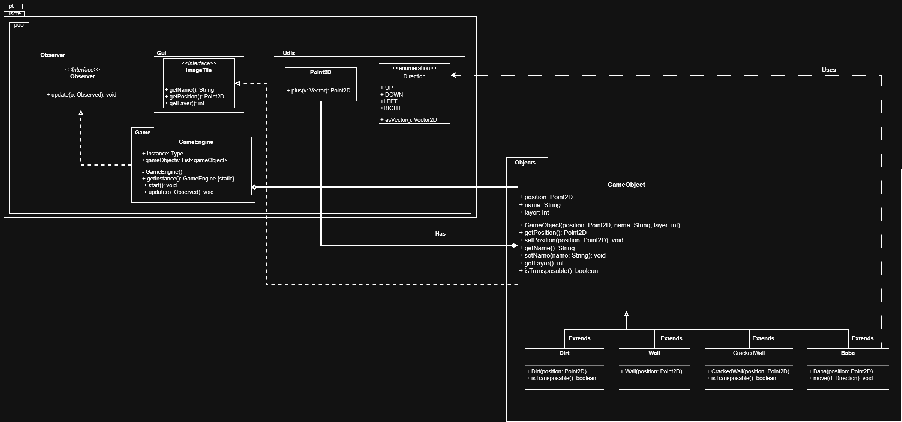
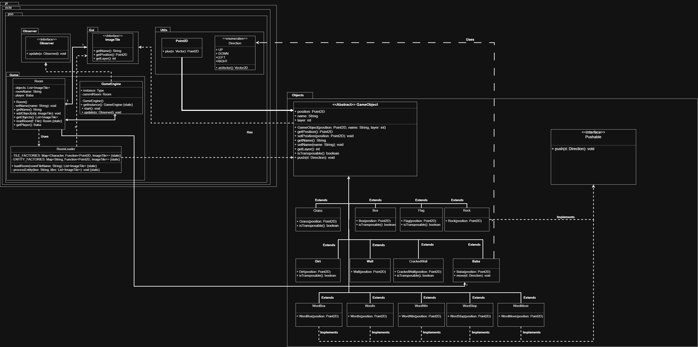

# Baba Is You — Projeto POO (CheckPoint 1)

Este projeto foi desenvolvido no âmbito da unidade curricular de **Programação Orientada aos Objetos (POO)**.

## 👥 Autores

- **Roman Havrylenko** — Número: `124359`
- **Carmindo de Severino Delvan** — Número: `111972`

---

## 📌 Descrição do Projeto

Este projeto consiste numa adaptação do jogo **"Baba Is You"**. O objetivo desta primeira fase (CheckPoint 1) é a criação da arquitetura base de classes, a definição da hierarquia dos objetos do jogo e a configuração da interação com o motor gráfico.

---

## 📐 Diagrama de Classes UML (CheckPoint 1)

Abaixo é apresentado o diagrama de classes UML que descreve a estrutura e as relações entre os principais componentes do projeto nesta etapa:

### Principais Blocos da Arquitetura:
- **`ImageTile`** (`pt.iscte.poo.gui`): Interface para a representação gráfica dos objetos no tabuleiro do jogo.
- **`GameObject`** (`objects`): Classe abstrata base para todas as entidades do jogo (posição, camada de visualização, nome).
- **Entidades do Jogo** (`objects`): 
  - `Baba` — personagem principal com funcionalidade de movimento (`move`).
  - `Dirt`, `Wall`, `CrackedWall`, `Grass` — obstáculos e elementos do ambiente.
- **`GameEngine`** (`pt.iscte.poo.game`): *Singleton* que gere o ciclo do jogo e a atualização do estado.
- **`Point2D` & `Direction`** (`pt.iscte.poo.utils`): Classes auxiliares para manipulação de coordenadas e direções.

---

## 📐 Diagrama de Classes UML (CheckPoint 2)

Abaixo é apresentado o diagrama de classes UML que descreve a estrutura e as relações entre os principais componentes do projeto nesta etapa:

### Principais Blocos e Atualizações da Arquitetura:
- **`ImageTile`** (`pt.iscte.poo.gui`): Interface para a representação gráfica dos objetos no tabuleiro do jogo[cite: 3].
- **`Pushable`** (`objects`): Nova interface implementada pelos elementos que podem ser empurrados pela personagem (`Rock` e os objetos de palavras)[cite: 1, 4].
- **`GameObject`** (`objects`): Classe abstrata base para todas as entidades do jogo (posição, camada de visualização, nome e comportamento de colisão)[cite: 3].
- **Entidades do Jogo e Palavras** (`objects`): 
  - `Baba` — personagem principal com funcionalidade de movimento (`move`) e interação com objetos empurráveis[cite: 1, 3].
  - `Dirt`, `Wall`, `CrackedWall`, `Grass` — elementos do ambiente e obstáculos[cite: 3, 4].
  - `Rock`, `Box`, `Flag` — objetos interativos do nível (pedra empurrável, caixa com comportamento dinâmico e bandeira de objetivo)[cite: 1, 3, 4].
  - `WordBox`, `WordIs`, `WordWin`, `WordStop`, `WordMove` — blocos de palavras empurráveis que permitem alterar as regras do nível (ex.: `BOX IS WIN`)[cite: 1, 3, 4].
- **`GameEngine`** (`pt.iscte.poo.game`): *Singleton* que gere o ciclo do jogo, a sala atual, a verificação de regras dinâmicas e o estado de vitória[cite: 1, 3].
- **`Room` & `RoomLoader`** (`pt.iscte.poo.game`): Classes responsáveis por armazenar os objetos de cada nível e efetuar a leitura e construção do mapa a partir dos ficheiros de configuração[cite: 4].
- **`Point2D` & `Direction`** (`pt.iscte.poo.utils`): Classes auxiliares para manipulação de coordenadas e direções[cite: 3].

---

## 🛠 Tecnologias

- **Linguagem de Programação:** Java
- **Paradigma:** Programação Orientada aos Objetos (POO)
- **Ferramenta de Modelação UML:** draw.io
